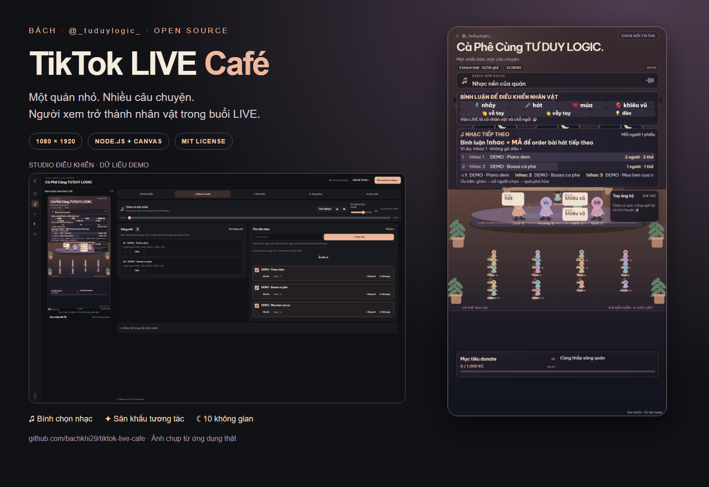

# ☕ TikTok LIVE Café

Quán cà phê tương tác dành cho TikTok LIVE: người xem vào quán bằng nhân vật, trò chuyện, lên sân khấu nhảy/hát/múa và cùng chọn bài nhạc tiếp theo.

 Dự án chạy cục bộ bằng **Node.js + WebSocket + HTML Canvas**, có Studio điều khiển và overlay dọc **1080 × 1920**.



*Ảnh chụp từ ứng dụng với khách và tương tác DEMO; không phải số liệu từ một buổi LIVE thật.*

[Xem overlay dọc ở kích thước đầy đủ](docs/images/overlay.png) · [Xem Studio điều khiển](docs/images/studio.png)

## Các tính năng

- Nhân vật nhận sự kiện vào phòng/bình luận; bong bóng chat theo nhân vật lên sân khấu. Có avatar TikTok khi sự kiện cung cấp ảnh.
- Sáu điệu nhảy, cầm mic hát, múa lụa, khiêu vũ đôi, vỗ tay, vẫy tay và hiệu ứng đèn. Điều chỉnh 1–100 chỗ sân khấu, tối đa 200 ghế trong quán.
- Tải nhạc vào thư viện, **tích bài nào thì bài đó hiện mã `!nhac` trên overlay**. Bỏ tích để ẩn; đổi tên hiển thị mà không đổi file.
- Bình chọn nhạc: mỗi người một phiếu. Ưu tiên chủ quán ghim/sắp xếp → số người chọn → giá trị quà khi bằng phiếu → thứ tự đề cử.
- Chủ quán có thể phát ngay, tạm dừng, tua, bỏ bài, ghim và sắp xếp hàng chờ; âm lượng đồng bộ thiết bị phát tiếng, nhạc giảm khi có giọng đọc.
- Giọng tiếng Việt Hoài My/Nam Minh, chỉnh tốc độ/độ cao, lời đọc một chạm, câu cảm ơn quà/follow tùy chỉnh và file thu âm riêng.
- 10 cảnh: cà phê đêm, concert neon, vườn ánh trăng, rooftop, tiệm sách, bờ biển, góc mưa, arcade, hoa anh đào và nhà gỗ.
- Thử tương tác khi chưa LIVE: tạo khách DEMO, gửi bình luận, thử quà và follow. Số liệu DEMO tách khỏi số liệu thật.

## Cài và chạy

Cần **Node.js 20 trở lên** và trình duyệt hiện đại. Không có bước build.

### Windows: tải ZIP và mở nhanh

1. Trên GitHub, chọn **Code → Download ZIP**, sau đó giải nén.
2. Cài Node.js nếu máy chưa có.
3. Mở `start-cafe.cmd`. Lần đầu chương trình tự cài các gói cần thiết.
4. Vào **http://localhost:3000** để mở Studio.
5. Bấm **Mở overlay & tiếng**, rồi **Bật âm thanh** trong cửa sổ quán.

### Hoặc dùng Terminal

```bash
git clone https://github.com/bachkhi29/tiktok-live-cafe.git
cd tiktok-live-cafe/live
npm ci
npm start
```

Khung xem trước trong Studio luôn im lặng; cửa sổ overlay riêng phát tiếng. Chỉ bật tiếng ở một overlay tại một thời điểm.

## Thử trước khi LIVE

Trong **Điều khiển**, chọn **12 khách**, gửi `nhảy`, `hát`, `múa`, `khiêu vũ`, hoặc thử quà/follow. Chọn **100 khách** rồi **12 khách** sẽ giảm đúng số khách DEMO do các nút tạo. Khách thật và khách thử bằng tên riêng được giữ lại.

Trong **Giao diện**, đặt tên quán, lời chào, cảnh và số ghế theo kênh của bạn. Trong **Giọng đọc**, nhập một câu và bấm **Đọc lên** để thử âm thanh.

## Thêm nhạc và cho người xem order

1. Vào **Nhạc & order → + Thêm file**. Hỗ trợ MP3, WAV, OGG, M4A; tối đa 100 MB/file.
2. File mới chỉ nằm trong thư viện. **Tích bài muốn cho người xem chọn**: mã bài xuất hiện ngay trên băng chuyền overlay.
3. Người xem bình luận `!nhac 1` (thay `1` bằng mã đang hiện). Không gõ dấu `+`.
4. Bấm **Sửa tên** để đặt tên dễ đọc hơn; **+ Hàng chờ** hoặc **Phát ngay** để chủ quán tự chọn.
5. Bỏ tích để gỡ khỏi order. Bài đang chờ bị gỡ; bài đang phát sẽ dừng nếu bị bỏ tích. **Ẩn tất cả** gỡ toàn bộ danh sách order.

Tên bài và lựa chọn được lưu. Mã số có thể đổi khi thêm/gỡ bài; dùng mã đang hiển thị trên overlay.

Repo **không kèm nhạc thương mại**. Thêm file bạn có quyền sử dụng; file nhạc trong `assets/radio/` được Git bỏ qua. Khi chưa có bài order, quán có sáu kiểu nhạc nền tổng hợp bằng Web Audio.

## Lệnh tương tác

| Bình luận | Hoạt động |
| --- | --- |
| Một câu bất kỳ | Tạo nhân vật nếu chưa có và hiện bong bóng trò chuyện |
| `nhảy`, `nhảy 1` … `nhảy 6` | Lên nhảy hoặc đổi điệu |
| `hát` | Lên sân khấu cầm mic; đây là hoạt ảnh, không tạo giọng hát thật |
| `múa` | Múa lụa |
| `khiêu vũ` | Ghép đôi với người cùng chọn khi có chỗ |
| `vỗ tay`, `vẫy tay`, `đèn` | Hưởng ứng và điều khiển hiệu ứng |
| `!nhac MÃ` | Chọn bài tiếp theo; mặc định mỗi người có một phiếu |
| `!uong latte`, `!uong den`, `!uong tra`, `!uong cacao` | Đổi đồ uống |
| `!ao 1` … `!ao 6` | Đổi màu/trang phục nhân vật |

Các động tác có thời gian chờ chống spam. Chủ quán có thể tắt biểu diễn miễn phí và chỉnh quy tắc quà trong Studio.

## Kết nối TikTok LIVE thật

1. Bắt đầu LIVE công khai trên kênh bằng một cách mà tài khoản được cấp quyền.
2. Trong Studio quán, mở **Kết nối TikTok**, nhập username kênh (không phải URL) và bấm **Kết nối**.
3. Kiểm tra trạng thái đã nối; dùng tài khoản xem khác thử bình luận/quà/follow.

Kết nối sự kiện dùng thư viện cộng đồng `tiktok-live-connector`, không yêu cầu nhập mật khẩu/cookie TikTok vào quán. Việc nhận sự kiện và phát hình/tiếng là hai luồng riêng: quán **không tự cấp quyền LIVE Studio, chia sẻ màn hình hoặc stream key**. TikTok và dịch vụ kết nối thay đổi có thể làm việc nhận sự kiện lỗi; DEMO chỉ kiểm tra ứng dụng cục bộ.

### Phát hình từ PC

- Với nguồn Website/Link: dùng **http://localhost:3000/live/overlay.html** ở 1080 × 1920.
- Với chụp cửa sổ: mở `open-overlay.cmd`, bật tiếng, giữ cửa sổ được chụp mở.
- Nguồn hình im lặng cho OBS: **http://localhost:3000/live/overlay.html?capture=1**; tiếng lấy từ overlay thường.

Chi tiết: [Hướng dẫn LIVE Studio / OBS](LIVE-STUDIO.md).

### Phát bằng iPhone

1. Trên PC mở `start-phone.cmd`, giữ cửa sổ server chạy.
2. PC và iPhone cùng mạng nội bộ. Mở **nguyên link iPhone** được in trong server bằng Safari.
3. Chọn **Chia sẻ → Thêm vào Màn hình chính**, mở **Cà Phê LIVE** và bấm **Bật âm thanh**.
4. Nếu tài khoản TikTok có chia sẻ màn hình, bắt đầu phát rồi chuyển sang Cà Phê LIVE. PC vẫn dùng Studio để điều khiển.

Chế độ Màn hình chính bỏ thanh công cụ Safari; thanh trạng thái iPhone do iOS quản lý và không được bảo đảm ẩn hoàn toàn. Link có mã riêng theo phiên và đổi khi mở lại server. Xác nhận hình/tiếng từ máy xem khác trước khi phát lâu dài.

Chi tiết: [Hướng dẫn iPhone](IPHONE-LIVE.md).

## Âm thanh, dữ liệu và giới hạn

- Bấm **Bật âm thanh** trong overlay sẽ phát tiếng. Âm lượng PC không điều khiển âm lượng phần cứng iPhone.
- Thanh nhạc chung trên Studio điều khiển nhạc ở thiết bị phát tiếng; nhạc giảm khi giọng đọc hoạt động. Có điều chỉnh riêng cho giọng và nhạc nền.
- TTS ưu tiên Edge; khi lỗi thử nguồn tiếng Việt dự phòng Google. Cả hai cần Internet và có thể gián đoạn. Có thể dùng file giọng thu âm riêng.
- Cấu hình, tên bài, danh sách đã tích và lời đọc lưu ở `live/data/studio.json`. Dùng xuất/nhập cấu hình để sao lưu.
- Khách, quà, lượt biểu diễn và phiếu nhạc giữ trong phiên; tắt server sẽ đặt lại. Bộ đếm nhân vật không phải số người xem đồng thời trên TikTok; chưa có xử lý người xem rời phòng.
- Server mặc định chỉ mở trên máy. Chế độ iPhone mở trong LAN có mã truy cập; chưa có đăng nhập để vận hành như dịch vụ công khai trên Internet.

Tài liệu chức năng đầy đủ: [Hướng dẫn sử dụng](docs/USER-GUIDE.md).

## Xử lý lỗi thường gặp

| Vấn đề | Cách kiểm tra |
| --- | --- |
| Tích/bỏ tích không đổi overlay | Nếu Studio báo server cũ, đóng server và mở lại `.cmd`, rồi tải lại Studio. Tải lại trình duyệt không cập nhật tiến trình Node đang chạy. |
| iPhone yêu cầu mở phone link | Dùng nguyên link mới có `?t=` trong server; đừng dùng `localhost` trên iPhone. |
| Không có tiếng | Mở overlay riêng, bấm Bật âm thanh; kiểm tra nguồn âm thanh trên Studio và âm lượng thiết bị. |
| Không nhận chat | Kiểm tra LIVE công khai, username và nhật ký kết nối. Quán vẫn chạy DEMO khi chưa nối LIVE. |
| File thêm rồi chưa có mã | Tích bài trong thư viện. Chỉ các bài đang tích mới được order. |
| Cửa sổ chụp bị mờ | Dùng nguồn 1080 × 1920; phóng cửa sổ nhỏ không tạo thêm chi tiết ảnh. |
| Port 3000 đang dùng | Đóng server cũ hoặc đặt biến môi trường `PORT` để dùng cổng khác. |

## Phát triển và kiểm tra

```bash
cd live
npm ci
npm run check
npm test
```

Kiểm tra bổ sung: `npm run test:ui` cần Chrome (`CHROME_PATH` nếu đường dẫn khác); `npm run test:phone` cần địa chỉ LAN; `npm run test:voice` cần Internet. Các kiểm tra không tự kết nối kênh LIVE thật. Ảnh test lưu ở `live/artifacts/`.

`live/.npmrc` bỏ qua các hook lúc cài dependency vì các gói đã kèm JavaScript biên dịch sẵn; điều này cũng tránh hook chọn package manager của `msedge-tts` khi dùng npm. Các lệnh `npm run check`, `npm test` và `npm start` vẫn chạy bình thường.

Tạo lại bộ ảnh README bằng `node scripts/capture-overview.mjs` trong thư mục `live` (cần Chrome). Script mở server riêng, tạo dữ liệu DEMO và kiểm tra tích/bỏ tích bài trên giao diện; không dùng cấu hình hay kết nối LIVE đang chạy.

```text
live/
  server.mjs          HTTP, WebSocket, TikTok, TTS và lưu cấu hình
  cafe.mjs            Logic khách, sân khấu, quà và nhạc
  control.html/js     Studio của chủ quán
  overlay.html/js     Màn hình LIVE 1080 × 1920
  audio-engine.js     Nhạc, giọng đọc và giảm nhạc khi đọc
  scene-renderer.js   Các không gian quán
  motion.js           Hoạt ảnh nhân vật
  bubble-layout.js    Bố trí bong bóng bình luận
  test/               Kiểm tra tự động
assets/radio/         Nhạc người dùng thêm, không đưa vào Git
docs/                 Ảnh giới thiệu và tài liệu chi tiết
```

## Đóng góp và giấy phép

Có thể fork, chỉnh sửa và chia sẻ theo [MIT](LICENSE). Cách báo lỗi và gửi thay đổi: [CONTRIBUTING.md](CONTRIBUTING.md).

Phát triển từ [Chánh Điện Online của Kent Juno](https://github.com/kentjuno/chanh-dien-online). Giữ thông báo bản quyền gốc theo MIT; mã quán, hoạt ảnh và Studio được phát triển tiếp bởi Bách. Ảnh và nhạc chùa cũ đã được loại khỏi bản phân phối. [Tài liệu upstream](UPSTREAM.md) được giữ để ghi nhận nguồn gốc.
